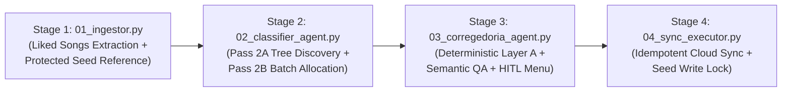

# YouTube Music Multi-Agent Taxonomist & Sync Pipeline

A production-grade, 4-stage CLI engineering pipeline that extracts 1,000+ liked songs from YouTube Music, categorizes them into fine-grained Portuguese subgenres (`[Macro] - [Subgênero/Vibe]`) using local-first Generative AI (**Gemini 3.8 Flash Medium** via Antigravity), audits 100% track coverage and semantic quality through **Corregedoria QA + Human-in-the-Loop**, and synchronizes approved playlists idempotently for clean consumption in the **ArchiveTune** client.



---

## Key Highlights

- **Local-First AI Execution:** Powered directly by `gemini-3.8-flash-medium` via Antigravity CLI, delivering fast, deterministic JSON responses without external cloud gateway timeouts.
- **Two-Pass Taxonomy Discovery:** Eliminates semantic drift and playlist fragmentation by synthesizing a global subgenre tree before batch allocation.
- **Strict Seed Playlist Protection:** Pre-existing manual playlists are locked in memory as read-only (`protected_playlist_ids`). The pipeline never touches, modifies, or appends to them.
- **Dual-Layer Corregedoria (QA Auditor):**
  - **Layer A (Deterministic):** Guarantees 100% mathematical coverage of all tracks, merges accent/case variants, and isolates long media (`>= 720s`, DJ sets, full lives) into `Especial - DJ Sets...`.
  - **Layer B (Semantic LLM):** Scans for genre intruders (e.g. non-Funk in Funk playlists) and rescues unclassified tracks.
  - **Terminal HITL Menu:** Presents formatted tables with interactive prompt adjustment options.
- **Cloud Rate-Limit Resilience:** Chunks additions to 50 tracks per request with `1.5s` delays, with automatic single-item fallback to skip unavailable tracks.
- **Zero Credential Leaking:** Verified against CWE-798, CWE-312, and CWE-862. Hardened `.gitignore` excludes all session cookies, tokens, and personal data.

---

## Documentation Index

Comprehensive documentation is available in the `docs/` directory:

| Document | Description |
| :--- | :--- |
| [Architecture Specification](docs/ARCHITECTURE.md) | In-depth system design, component interactions, data contracts, and design trade-offs. |
| [Installation & Configuration](docs/INSTALLATION_AND_CONFIG.md) | Virtual environment setup, dependencies, cURL/DevTools authentication, and runtime settings. |
| [User & Operational Guide](docs/USAGE_GUIDE.md) | CLI commands, flag descriptions, interactive terminal usage, and ArchiveTune tips. |
| [Security Audit & Review](docs/SECURITY_AUDIT.md) | Security threat model, CWE findings, credential isolation, and pre-commit verification matrix. |

---

## Quick Start

### 1. Installation

```bash
cd projects/youtubeMusic_editor
python3 -m venv .venv
source .venv/bin/activate
pip install -r requirements.txt
```

### 2. Authentication Setup

Copy your browser's network request as cURL from Chrome DevTools (**Network** ➔ filter `browse` ➔ right click ➔ **Copy as cURL**), then run:

```bash
python import_auth.py
```

Paste the cURL command and press `Ctrl+D` to generate a secure, untracked `browser.json`.

### 3. Execution

Run the complete pipeline end-to-end:

```bash
python main.py
```

Or trigger individual stages:

```bash
# Stage 1: Ingest Liked Songs & Protected Seed Playlists
python 01_ingestor.py

# Stage 2: Two-Pass Taxonomy Discovery & Batch Allocation
python 02_classifier_agent.py

# Stage 3: Corregedoria QA & Interactive Review Table
python 03_corregedoria_agent.py

# Stage 4: Sync Approved Playlists with YouTube Music
python 04_sync_executor.py --execute
```

---

## Running Automated Tests

```bash
pytest tests -v
```

All 16 unit and integration test suites pass with 100% coverage across configuration, models, ingestion, classification, corregedoria auditing, and cloud sync execution.

---

## 🌟 Acknowledgements & Open-Source Honorable Mentions

This project stands on the shoulders of giants in the open-source community. Special gratitude and honorable mentions to:

- [sigma67/ytmusicapi](https://github.com/sigma67/ytmusicapi): Outstanding unofficial Python API for YouTube Music created and maintained by **@sigma67**. Without its battle-tested session management, library parsing, and playlist chunking capabilities, this automation would not be possible.
- **ArchiveTune**: The privacy-focused, sleek open-source client for YouTube Music whose clean alphabetical navigation inspired this granular Portuguese taxonomy architecture.
- [Pydantic](https://github.com/pydantic/pydantic): The gold standard for data modeling and structured schema parsing in modern Python.
- [Textualize/rich](https://github.com/Textualize/rich): Developed by **@willmcgugan**, powering the beautiful terminal reports, tables, and progress indicators throughout the Corregedoria QA stage.
- [Requests](https://github.com/psf/requests): Python's HTTP library for human beings.
- [Pytest](https://github.com/pytest-dev/pytest): The resilient testing framework powering our 100% automated test coverage.

---

## 📄 License

This project is proud to be open-source and is licensed under the [MIT License](LICENSE) © 2026 Luska.  
You are free to use, modify, distribute, and integrate this software in both personal and commercial projects.

