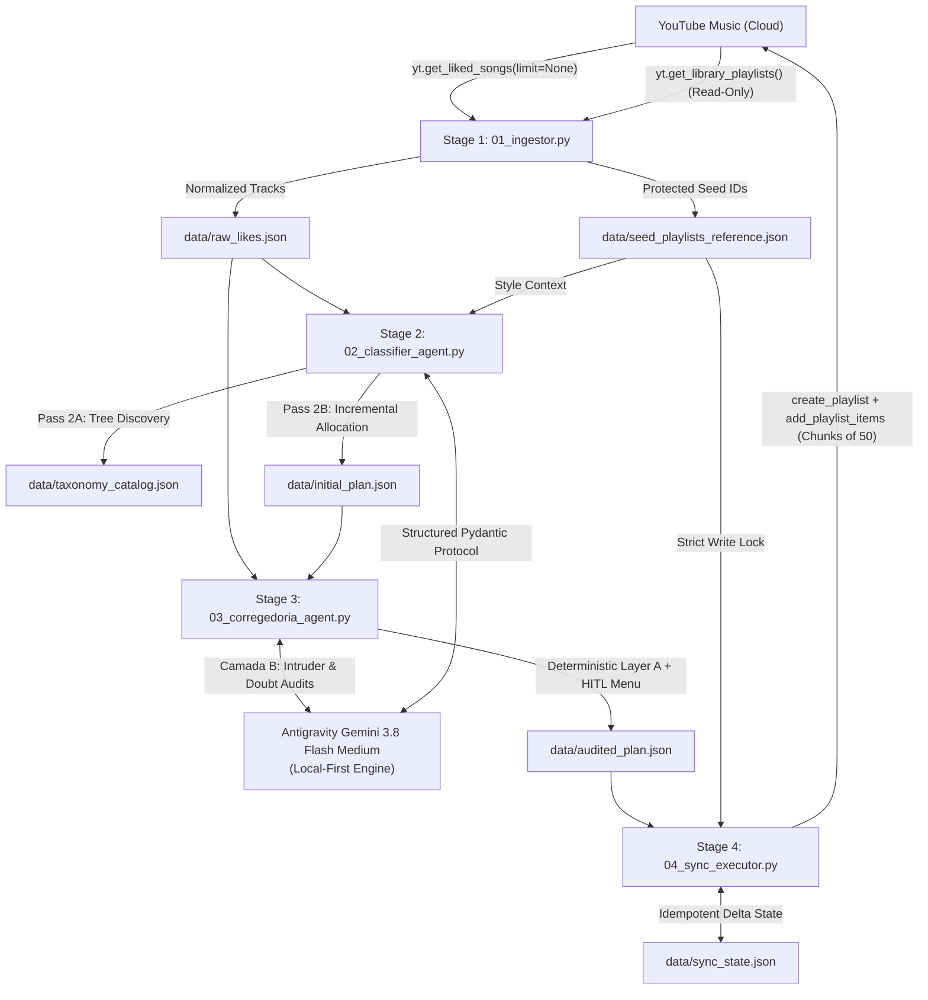

# System Architecture: YouTube Music Multi-Agent Taxonomist & Sync Pipeline

## 1. Executive Summary

The **YouTube Music Multi-Agent Taxonomist & Sync Pipeline** is a modular, 4-stage CLI engineering tool built to extract large libraries of liked songs from YouTube Music, categorize them into fine-grained Portuguese subgenres (`[Macro] - [Subgênero/Vibe]`) using local-first Generative AI, audit coverage and classification quality through automated and human-in-the-loop checkpoints, and synchronize approved playlists back to YouTube Music for consumption in the **ArchiveTune** client.

---

## 2. Core Architectural Pillars

### Pillar I: Multi-Stage Checkpointed State Isolation
The system never operates purely in-memory. Every stage consumes from and persists to dedicated JSON artifacts in `./data/`:
- `data/raw_likes.json`: Pure extracted track metadata normalized for minimal token overhead.
- `data/seed_playlists_reference.json`: Pre-existing user playlists flagged as protected read-only references.
- `data/taxonomy_catalog.json`: Dynamically discovered subgenre taxonomy tree.
- `data/initial_plan.json`: Proposed track-to-playlist mapping produced by Stage 2.
- `data/audited_plan.json`: Guaranteed 100% coverage plan vetted by Stage 3.
- `data/sync_state.json`: Mapping of `playlist_name -> playlistId` tracking cloud sync progress.

### Pillar II: Local-First Structured Generative AI
Rather than relying on brittle cloud gateways or high-latency external endpoints, the LLM adapter (`src/llm_adapter.py`) interfaces directly with Google Antigravity's native `gemini-3.8-flash-medium` engine:
- **Strict Pydantic Validation:** Enforces schema conformity on all responses (`TaxonomyCatalogResponse`, `BatchClassificationResponse`, `CorregedoriaReviewResponse`).
- **Sanitization & Fence Stripping:** Removes internal `<think>` blocks, markdown code blocks, and system notifications before JSON parsing.
- **Exponential Backoff:** Retries transient failures with exponential wait intervals.

### Pillar III: Two-Pass Taxonomy Strategy (Zero Semantic Drift)
When classifying 1,000+ tracks across 28+ batches, independent batch processing causes severe taxonomy fragmentation (e.g., generating redundant variants like `Funk - 150 BPM`, `Funk - Baile 150`, `Funk - Festa`).
1. **Pass 2A (Global Taxonomy Discovery):** Ingests the top 120 most frequent artists and a diverse sample of liked songs along with seed playlist titles to produce a coherent, standardized taxonomy catalog.
2. **Pass 2B (Batch Allocation):** Maps batches of 45 tracks against the active catalog, allowing new subgenres to be spawned only when an authentic musical niche emerges. Newly discovered subgenres are immediately committed to the catalog for subsequent batches.

### Pillar IV: Dual-Layer Corregedoria (Internal Affairs QA)
Before any cloud write action occurs, the audited plan must clear two independent verification layers:
1. **Layer A (Deterministic Invariants):**
   - **100% Mathematical Coverage:** Verifies `set(raw_likes_videoIds) == set(allocated_videoIds)`. Any orphan track omitted by LLM generation is caught and assigned.
   - **Fuzzy Name Merging:** Merges accent differences, casing, and typos (e.g., `Funk - Mandelao` merged into `Funk - Mandelão`).
   - **Duration & Media Routing:** Isolates long musical videos (`duration_seconds >= 720`, DJ sets, full live concerts, albums) into `Especial - DJ Sets, Lives & Álbuns Completos`.
2. **Layer B (Semantic LLM Audit):**
   - Segmented into compact chunks of 5 playlists (~5 KB per prompt) to respect operating system argument limits (`MAX_ARG_STRLEN`).
   - Relocates non-Funk intruders from `Funk - *` folders and rescues unclassified tracks from `Dúvida`.
3. **Human-in-the-Loop (HITL) Gate:** Renders an interactive terminal summary table allowing user approval, dry-run export, or natural-language adjustments.

### Pillar V: Cloud Idempotency & Seed Protection
- **Zero Touch on Pre-existing Playlists:** Pre-existing user playlists recorded in `seed_playlists_reference.json` (`protected_playlist_ids`) are hard-locked against any write or modification.
- **Chunked Insertion:** Track additions are executed in batches of 50 `videoIds` with a `1.5s` delay between requests.
- **Individual Fallback:** If a batch of 50 fails due to a single deleted or region-blocked video, the executor catches the error and retries items individually, logging unavailable tracks without crashing the pipeline.
