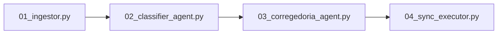

# User & Operational Guide

## 1. Pipeline Overview

The pipeline executes in 4 sequential stages. You can run the entire workflow end-to-end using `main.py` or trigger each stage individually using its dedicated CLI script.



---

## 2. Running the Full Pipeline (`main.py`)

The main orchestrator coordinates all 4 stages, carrying state seamlessly between checkpoints:

```bash
# Run the interactive pipeline (Stages 1 -> 2 -> 3 HITL -> 4)
python main.py

# Run a non-interactive dry-run (Stages 1 -> 2 -> 3, skipping cloud sync)
python main.py --dry-run

# Run a specific stage only (e.g., Stage 3)
python main.py --stage 3

# Execute Stage 4 directly with explicit authorization
python main.py --stage 4 --execute
```

### Supported CLI Flags
- `--stage {all,1,2,3,4}`: Selects which stage(s) to execute (default: `all`).
- `--auth PATH`: Path to custom `browser.json` or `oauth.json`.
- `--batch-size INT`: Batch size for Stage 2 (default: `45`).
- `--full-reclassify`: Discards previous Stage 2 checkpoints and reclassifies all tracks from scratch.
- `--execute`: Confirms authorization to create and populate playlists in YouTube Music.
- `--dry-run`: Exports the audited plan without prompting for cloud synchronization.

---

## 3. Step-by-Step Individual Stage Execution

### Stage 1: Ingestion & Seed Reference Extraction (`01_ingestor.py`)

Extracts 100% of your liked tracks from YouTube Music (`limit=None`) and captures an overview of your pre-existing playlists to use strictly as a style guide:

```bash
python 01_ingestor.py
```

- **Output Artifacts:**
  - `data/raw_likes.json`: Sanitized tracks containing `videoId`, `title`, `artists`, `album`, `duration_seconds`, and `videoType`.
  - `data/seed_playlists_reference.json`: List of pre-existing playlist IDs locked as `protected_playlist_ids` to guarantee zero modification.

---

### Stage 2: Two-Pass Taxonomist & Batch Classifier (`02_classifier_agent.py`)

Classifies tracks into granular Portuguese subgenres using a two-pass strategy:

```bash
python 02_classifier_agent.py
```

- **Pass 2A:** Generates `data/taxonomy_catalog.json` by analyzing the global artist distribution and liked tracks sample.
- **Pass 2B:** Evaluates tracks in batches of 45. Long musical media (`>= 720s`, sets, lives) is routed to `Especial - DJ Sets, Lives & Álbuns Completos`. Non-music videos (podcasts, tutorials) are isolated in `Não-Música - *`.
- **Incremental Delta Sync:** If you like new songs in the future, running this script only classifies the newly added tracks, preserving existing allocations.
- **Forced Reclassification:** To reclassify all tracks from scratch:
  ```bash
  python 02_classifier_agent.py --full-reclassify
  ```

---

### Stage 3: Corregedoria QA Auditor & Interactive Menu (`03_corregedoria_agent.py`)

Audits the preliminary plan before any write action is taken on YouTube Music:

```bash
python 03_corregedoria_agent.py
```

1. **Automated Verification:**
   - Invariant check: Verifies that 100% of tracks in `raw_likes.json` are allocated.
   - Merges duplicate/accented playlist names (e.g., `Funk - Mandelao` into `Funk - Mandelão`).
   - Runs semantic chunk audits to relocate any intruders (e.g., non-Funk tracks in Funk folders).
2. **Terminal Interactive Menu:**
   Displays a formatted summary table:
   ```text
   ┏━━━━━━━━━━━━━━━━━━━━━━━━━━━━━━━━┳━━━━━━━━━━━━━━━┳━━━━━━━━━━━━━━━━━━━━━━━━━━━━━━━┓
   ┃ Nome da Playlist               ┃ Qtd de Faixas ┃ 3 Exemplos de Artistas/Faixas ┃
   ┡━━━━━━━━━━━━━━━━━━━━━━━━━━━━━━━━╇━━━━━━━━━━━━━━━╇━━━━━━━━━━━━━━━━━━━━━━━━━━━━━━━┩
   │ Acústico - Violão Solo & Finge │           135 │ Sungha Jung - ...             │
   │ Funk - Mandelão & Automotivo   │           113 │ DJ K - ...                    │
   │ Rock - Clássico & Arena Rock   │            86 │ Supertramp - ...              │
   ...
   ```
   Interactive Options:
   - `[1] Aprovar e Sincronizar com YouTube Music`: Saves `data/audited_plan.json` and triggers Stage 4.
   - `[2] Pedir ajuste à Corregedoria via prompt`: Allows typing natural-language adjustment instructions (e.g., *"Junte a pasta X com a Y"*, *"Divida a pasta Z"*).
   - `[3] Exportar plano final e sair (Dry-Run)`: Saves the audited plan and exits safely.

---

### Stage 4: Idempotent Cloud Synchronizer (`04_sync_executor.py`)

Creates and populates approved playlists in your YouTube Music account:

```bash
python 04_sync_executor.py --execute
```

- **Safety Gate:** Requires the `--execute` flag to prevent accidental execution.
- **Protected Seed Safety:** Validates every playlist ID against `protected_playlist_ids` to ensure pre-existing manual playlists are never written to.
- **Idempotency:** Reads and updates `data/sync_state.json`. If interrupted, re-running the script only syncs remaining unadded tracks.
- **Rate-Limit Resilience:** Adds tracks in chunks of 50 with a 1.5-second sleep interval. If a batch fails due to an unavailable track, it falls back to item-by-item addition and logs failed IDs without crashing.

---

## 4. ArchiveTune Integration Notes

- All playlist titles follow the `[Macro] - [Subgênero/Vibe]` pattern.
- In **ArchiveTune**, playlists are automatically alphabetized, neatly grouping related subgenres together:
  - `Eletrônica - Eurodance & Flashback 90s`
  - `Eletrônica - Festival EDM & Clubbing`
  - `Eletrônica - French Touch, Nu-Disco & House`
  - `Funk - Consciente & Mensagem`
  - `Funk - Mandelão & Automotivo`
  - `Funk - Putaria & Sarra Sarra`
  - `Rock - Alternativo, Grunge & 2000s`
  - `Rock - Clássico & Arena Rock`
