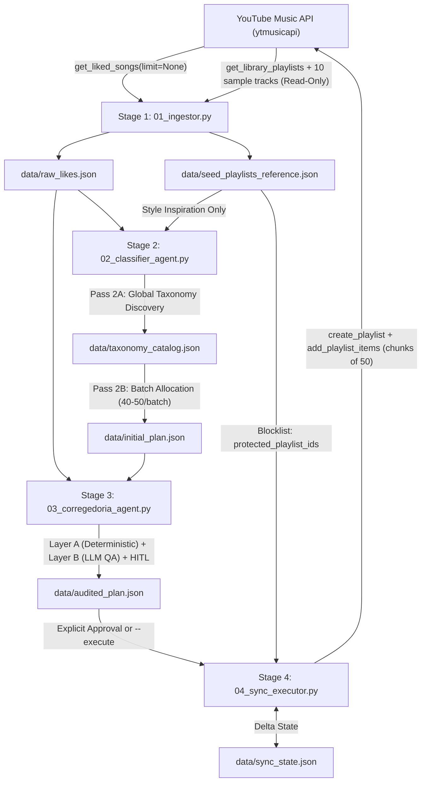

# YouTube Music Multi-Agent Taxonomist & Sync Pipeline — System Design Specification

## 1. Intent and Why
The user has over 1,000 liked songs (`'LM'` playlist) on YouTube Music and listens to them through the **ArchiveTune** client. Because YouTube Music's single "Liked Songs" bucket mixes disparate genres, 1-hour live sets, and non-musical videos (podcasts, tutorials, random clips), browsing by vibe in ArchiveTune is impractical.

This project provides a 4-stage, checkpointed multi-agent CLI pipeline in Python that:
1. Extracts all liked songs and reads the user's pre-existing playlists as a **Read-Only Style Reference** (`seed_playlists_reference.json`).
2. Uses a **Two-Pass Taxonomy & Allocation** strategy powered by Maestro's centralized NVIDIA LLM cascade (`core.llm`) to classify every track into granular Portuguese subgenres (`[Macro] - [Subgênero/Vibe]`).
3. Runs an uncompromising **Corregedoria (Internal Affairs QA)** stage combining deterministic Python invariants (100% track coverage, fuzzy deduplication, duration guards) with a secondary LLM semantic auditor (Funk isolation, non-music detection, `Dúvida` rescue) and a terminal Human-in-the-Loop (HITL) approval/adjustment loop.
4. Synchronizes approved playlists to YouTube Music via `ytmusicapi` with **Delta Sync** idempotency while strictly protecting all pre-existing user playlists (`protected_playlist_ids`).

## 2. Goals, Non-Goals, and Anti-Goals
- **Goals:**
  - 100% coverage of all `videoId` items present in `data/raw_likes.json`.
  - Granular Portuguese naming (`[Macro] - [Subgênero/Vibe]`) sorted alphabetically for ArchiveTune.
  - Zero modification of pre-existing ("seed") playlists in the user's YouTube Music library.
  - Direct reuse of Maestro's `core.llm` NVIDIA cascade (`meta/muse-glimmer-30b` -> `nvidia/nemotron-3.5-lightning-30b-a3b` -> `z-ai/glm-5.3-flash` -> `deepseek-ai/deepseek-v4.1-flash` + indoor fallback) without duplicating API client code.
  - Incremental Delta Sync across runs so newly liked songs are classified and synced without re-uploading already synced tracks.
- **Non-Goals:**
  - Modifying, deleting, or appending tracks to pre-existing manual playlists in the user's account.
  - Building a web UI (all interaction is terminal-based via `rich`).
- **Anti-Goals (Failure Conditions Even If Code Runs):**
  - Creating generic macro-genre playlists like `Funk`, `Rock`, or `Eletrônica` without a `- [Subgênero]` suffix.
  - Allowing Funk tracks to leak into Pop/Hip-Hop/Electronic folders or non-Funk tracks to enter `Funk - *` folders.
  - Mixing long musical videos (`>= 12 minutes` / `720 seconds`, DJ sets, full albums, live concerts) into standard 3-minute song playlists instead of isolating them in `Especial - DJ Sets, Lives & Álbuns Completos`.
  - Touching any playlist in `protected_playlist_ids` during Stage 4 execution.

## 3. Constraints & Business Rules
1. **100% Portuguese Naming Pattern:** Every playlist must follow `[Macro] - [Subgênero/Vibe]` (e.g., `Funk - Mandelão`, `Funk - Festa & 150 BPM`, `Rock - Indie & Alternativo`, `MPB - Acústico & Voz e Violão`, `Eletrônica - Gaming, NCS & Monstercat`).
2. **Long Musical Videos Isolation (`>= 720s`):** Any musical video with `duration_seconds >= 720` (12+ minutes) or identified as a long UGC DJ Set / Live Concert / Full Album must be placed in `Especial - DJ Sets, Lives & Álbuns Completos`.
3. **Non-Music Isolation:** Any podcast, interview, cut, tutorial, tech review, or gameplay video (detected via `videoType == "MUSIC_VIDEO_TYPE_UGC"`, duration, title, or channel) must be isolated in:
   - `Não-Música - Podcasts, Entrevistas & Cortes`
   - `Não-Música - Vídeos Aleatórios & Tutoriais`
4. **Low-Confidence Fallback:** Ambiguous tracks must never be dropped; they go to `Dúvida - Sem Categoria Definida` in Stage 2 and undergo a rescue pass in Stage 3.
5. **Multi-Label Allowed:** A single `videoId` may belong to more than one subgenre playlist when genuinely hybrid.
6. **No Minimum Playlist Size:** Playlists with even 1–3 tracks are preserved.
7. **Rate-Limit Safety:** `add_playlist_items` calls are chunked to at most 50 `videoIds` per request with a `1.5s` delay (`time.sleep(1.5)`) between batches.

## 4. Approaches Considered
1. **Approach A — Independent Batch Classification + Post-Hoc Merge:** Classify batches of 45 songs independently and rely on Stage 3 to merge similar category names. *Rejected:* Across 25+ batches, LLMs invent dozens of overlapping subgenre names (`Funk - 150 BPM`, `Funk - Baile 150`, `Funk - Festa`), overwhelming post-hoc fuzzy matching.
2. **Approach B (Selected) — Two-Pass Global Taxonomy Discovery + Incremental Batch Allocation with Delta Sync:**
   - **Pass 2A** inspects the global artist/title distribution of `raw_likes.json` alongside `seed_playlists_reference.json` (read-only style reference) to synthesize a coherent `data/taxonomy_catalog.json`.
   - **Pass 2B** allocates tracks in batches of 45 against `taxonomy_catalog.json` (while permitting controlled creation of new `[Macro] - [Subgênero]` folders if an unseen niche appears, immediately registering the new folder into the active catalog for subsequent batches).
3. **Approach C — Hardcoded Fixed Taxonomy:** Restrict classification to a static list of 16 folders in code. *Rejected:* Violates the user's requirement to dynamically discover granular niches across 1,000+ diverse likes.

## 5. Architecture & Data Contracts
- **Directory Layout:**
  - `config.py`: Paths, constants (`BATCH_SIZE = 45`, `LONG_MEDIA_THRESHOLD_SECONDS = 720`, `SYNC_CHUNK_SIZE = 50`, `SYNC_SLEEP_SECONDS = 1.5`, `AUTO_PLAYLIST_TAG = "[Maestro Auto-Taxonomy]"`), and auth helper.
  - `src/models.py`: Pydantic v2 schemas for `TrackItem`, `SeedPlaylistRef`, `TaxonomyCategory`, `TaxonomyCatalogResponse`, `TrackClassification`, `BatchClassificationResponse`, `PlaylistPlan`, `AuditReport`, `CorregedoriaReviewResponse`, and `SyncState`.
  - `src/llm_adapter.py`: Imports `invoke_outdoor_cascade` and `invoke_chat` from Maestro's `core.llm`, injects Pydantic JSON schemas into prompts, strips markdown code fences/thinking blocks, validates responses with Pydantic, and retries with exponential backoff.
  - `src/ingestor.py` & `01_ingestor.py`: Stage 1 implementation and CLI entrypoint.
  - `src/classifier_agent.py` & `02_classifier_agent.py`: Stage 2 implementation and CLI entrypoint.
  - `src/corregedoria_agent.py` & `03_corregedoria_agent.py`: Stage 3 implementation and CLI entrypoint.
  - `src/sync_executor.py` & `04_sync_executor.py`: Stage 4 implementation and CLI entrypoint.
  - `main.py`: Full pipeline orchestrator with CLI flags (`--stage`, `--full-reclassify`, `--execute`, `--dry-run`, `--auth`).
